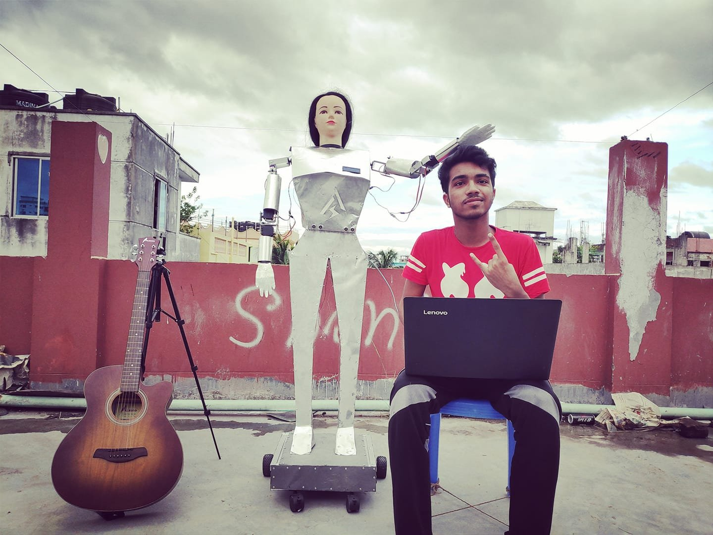
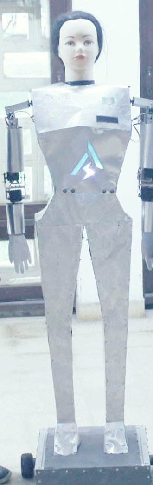
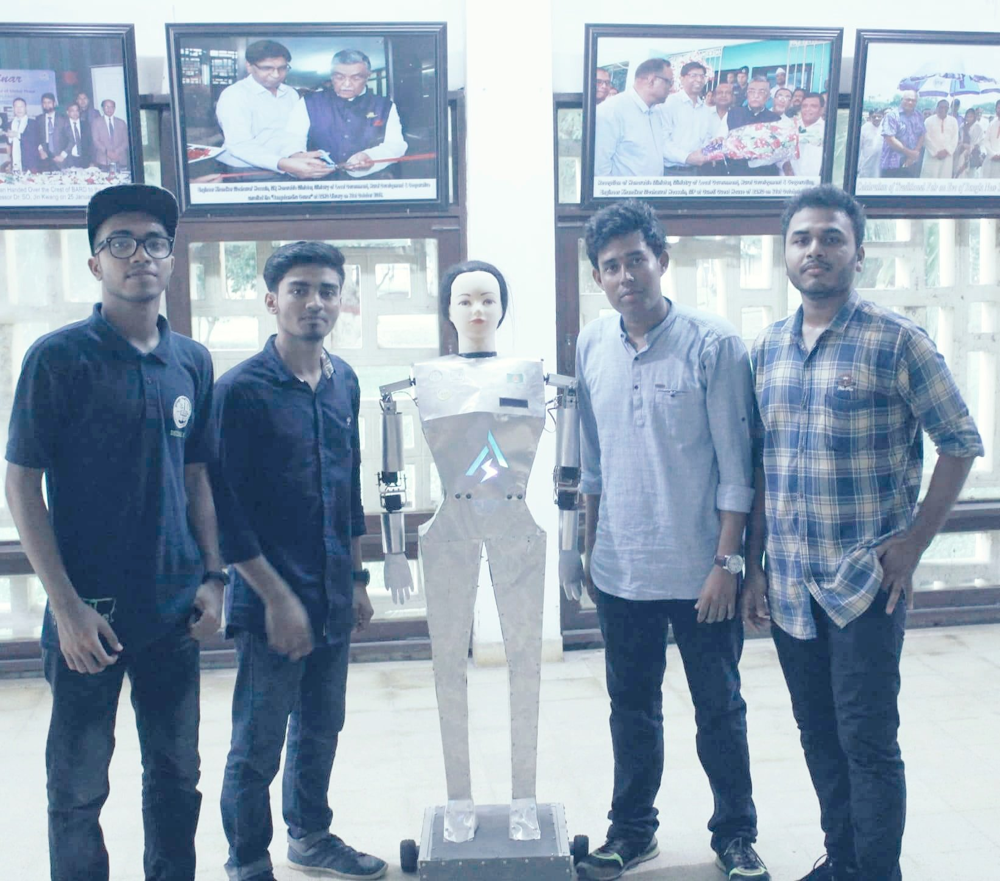

# Robot Sheena

A humanoid robot on wheels, controlled by voice from a phone: it salutes,
shakes hands, waves, raises its arms, turns its head and drives. It runs on
an Arduino with nine servos and two DC motors. Built by our team at Quanta
Robotics, first shown on TV in 2019; the code here was uploaded in 2020 and
2021.

**On TV:** [Jamuna TV's report on Sheena](https://www.youtube.com/watch?v=WyegetkAb0M)
(August 2019, in Bangla).

| | |
|---|---|
|  |  Sheena with four of the team |

## What it does

A phone app turns speech into text and sends it over Bluetooth as
`*command#`. [`firmware/sheena/sheena.ino`](firmware/sheena/sheena.ino)
matches 24 commands, several with other phrasings:

- **Gestures:** salute, handshake, wave ("hi", "bye"), left or right hand
  up and down, both hands up and down, move the head, turn the head left or
  right, and back to the rest pose ("okay").
- **Driving:** forward and back for a moment or until "stop", left, right,
  and a circle and a short dance, which run until "stop".

## How it works

| | |
|---|---|
| Board | An Arduino Mega, reading the Bluetooth module on its serial port at 9600 baud |
| Arms and head | Nine hobby servos: four in each arm (pins 8 to 11, and A0 to A3) and one turning the head (pin 7) |
| Wheels | Two DC motors on an H-bridge (pins 3 to 6), switched on and off |
| Body | Riveted metal sheet, with a lit logo on its chest |

## Repository layout

| Folder | Holds |
|---|---|
| [`firmware/sheena/`](firmware/sheena) | The robot's program |
| [`experiments/`](experiments) | The earliest saved version of the program (uploaded November 2020), a finger-servo test, and two tests of an ultrasonic sensor and an LCD that the robot doesn't use |
| [`docs/media/`](docs/media) | The photos on this page; the originals are in `originals/` |

## The team

Sheena was built by Quanta Robotics, the robotics team I co-founded at
Comilla University: Shanjit Mondol (circuit design), me (the program),
Sayed and Niaz al Masum.

It stands on others' work: the two ultrasonic sensor tests in
[`experiments/`](experiments) come from Dejan Nedelkovski's tutorials at
[HowToMechatronics](https://howtomechatronics.com/tutorials/arduino/ultrasonic-sensor-hc-sr04/).

## Run it

Upload `firmware/sheena/sheena.ino` from the Arduino IDE to an Arduino
wired as above, with a Bluetooth module such as an HC-05 on its serial
port. Disconnect the module while uploading, since it shares the pins.
Then send commands from a Bluetooth voice-control app that wraps each
phrase as `*command#`.

## Licence

My code is under the MIT licence: see [LICENSE](LICENSE). The two
ultrasonic tests are HowToMechatronics' and are not covered by it.
